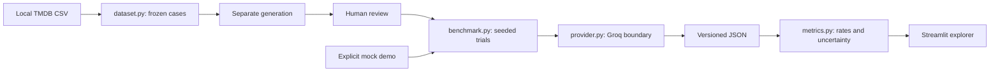

# Ultimate Judge

**A Reproducible Benchmarking Framework for LLM Judge Bias and Reliability**

Can we trust LLM-as-a-Judge? This project investigates when anonymous pairwise
judgments change under answer order, verbosity, style, and generator identity.
Movie recommendation is the first domain. This is a research prototype, not
evidence that either configured model is biased.

## Offline quick start

```bash
poetry install
poetry run python -m benchmark --config configs/demo.json
poetry run streamlit run app.py
```

The home page is the questions-to-answers-to-judges workflow. For the offline
demo, open the **Benchmark** analysis page. A fictional dataset and labeled
mock results are included. The mock judge always selects displayed A to exercise
order mapping and metrics. These are not real model measurements.

Open **Dashboard** in the sidebar for metric cards, validity over time, experiment
counts, model comparisons, preference profiles, and individual judgments. Select
one saved run and filter judges; optional 10-second refresh reads new saved progress
without making API calls. Choose **Offline demo** to explore the layout without a
key. Missing measurements display a dash; validity is not an answer-quality score.

For Docker, run `docker compose up --build` and open http://localhost:8501.
Local `data/` and `results/` are mounted so runs survive restarts. The image includes
the offline demo. The Docker engine was unavailable during local verification.

## Real benchmark

### Upload your own questions in Streamlit

On the **home page**:

1. Upload a `.txt` file (one question per line) or `.json` question list. Download
   the example in the app, or use `examples/questions.txt` / `questions.json`.
2. The server loads its existing `data/tmdb_5000_movies.csv` automatically. No dataset
   upload is needed. Each question gets up to six movie options through deterministic
   genre/title keyword lookup. JSON `movie_ids` override this selection.
3. Choose two **answer models** and click **Run test**. The app saves question inputs,
   generates answers and shows them **side by side**, with a question selector.
4. Answers are checkpointed in
   `.progress.json`; a frozen benchmark is written only after both models finish
   every question. Resume uses the same questions and answer models.
5. Choose **judge models** independently and click **Run judge**. Verdicts and
   metrics appear directly below the answers. The home-page buttons make real API
   calls; the separate analysis page offers the explicitly labeled offline demo.
6. Download answers/results or open detailed analysis. The analysis page also
   supports transformation review; unreviewed style/verbosity variants do not enter
   controlled preference metrics.

The CSV is a local movie catalog; no database server is needed. Keyword lookup is
not a general constraint solver: inspect the automatically selected facts in the
preview. The uploader does not infer machine-readable constraints or invent human
quality labels. Existing manual-CSV code is retained in `legacy_app.py` for compatibility.

### Use the included 30 scenarios

Download `tmdb_5000_movies.csv` from the
[TMDB dataset](https://www.kaggle.com/datasets/tmdb/tmdb-movie-metadata) into `data/`.
Respect the source terms; raw data is not committed.

```bash
poetry run python -m dataset data/tmdb_5000_movies.csv
```

This writes `data/scenarios.json`: 30 scenario instances from six question templates,
with no answers. Compare its source hash with `benchmark-manifest.json`. Older
template files remain untouched but are not presented as ready-to-judge benchmarks.

Obtain one [GroqCloud key](https://console.groq.com/keys) and set `GROQ_API_KEY` in
your environment. For Docker, copy `.env.example` to `.env` and set it there.
Local Python reads the environment, not `.env`. The UI no longer accepts keys.
No key is saved in experiment files.

```bash
poetry run python -m benchmark --verify-models
```

The defaults remain `openai/gpt-oss-20b` and `qwen/qwen3.8-27b`. Availability can
change; Qwen is a preview model. Set `RUN_LIVE_TESTS=1` alongside the key to enable
`poetry run pytest tests/test_live.py -q`. That test lists models and makes two
model calls; ordinary tests never require credentials.

Generate candidate responses separately (up to 60 successful calls):

```bash
poetry run python -m benchmark --generate data/scenarios.json --answer-models openai/gpt-oss-20b qwen/qwen3.8-27b --output data/generated-benchmark.json
```

Generation checkpoints answers separately from the final benchmark. Changing the
selected models requires a different output file. Review the answers and transformations
in the dashboard. Approvals save to `data/reviewed-benchmark.json`; select that file
for subsequent review/run work. Controlled verbosity/style metrics exclude
unreviewed transformations. Human quality labels start uncertain.

Edit `configs/live.json` to use the reviewed snapshot and desired cases/budget:

```bash
poetry run python -m benchmark --config configs/live.json
```

The initial live configuration selects just one case. All four conditions with
two judges and three trials require 60 judgments per case, or 1,800 for 30 cases,
before retries. This can exceed free daily limits. Resume with the same config;
increasing the request budget continues the same run. No paid upgrade is automatic.

## Dashboard

- Existing CSV workflow and version-1 JSON import/export remain available.
- Benchmark filters select judge, scenario, condition and trial.
- Explore displayed answers, canonical winner, explanation and raw response.
- Inspect consistency, flips, repeatability, preference rates, ties and failures.
- Metrics show numerators, denominators, case counts and cluster-bootstrap intervals.
- Compare generator-by-judge preferences, quality strata and matched disagreements.

## Architecture



`models.py` and `runner.py` retain the original interactive interface.
`benchmark_models.py` defines benchmark records. `dataset.py`, `provider.py`,
`benchmark.py` and `metrics.py` separate data, API calls, execution and analysis.
`pages/1_Benchmark.py` adds the dashboard. No database or orchestration service.

## Validation

```bash
poetry run pytest -q
poetry check
docker compose config --quiet
docker compose up --build -d
curl http://localhost:8501/_stcore/health
```

GitHub Actions runs offline tests, the demo, Docker build and container health checks.
`tests/expected-demo-metrics.json` is a software regression fixture, not a model
performance baseline. Natural LLM variation is not a deterministic test failure.

## Limitations and roadmap

Read the [methodology](docs/methodology.md), [dataset card](docs/dataset-card.md), and
[implementation status](docs/status.md). The initial 30 cases are built, but human
reviews and real measurements remain pending. Self-preference is confounded by
quality; formatting and repetition can legitimately change quality. Small selected
samples and zero-temperature API calls do not establish universal reliability.

Deferred: run-regression comparisons, cost estimates, adjustable concurrency, and
broader transformations. Current concurrency is one. No empirical model findings
or statistical significance claims are asserted.
